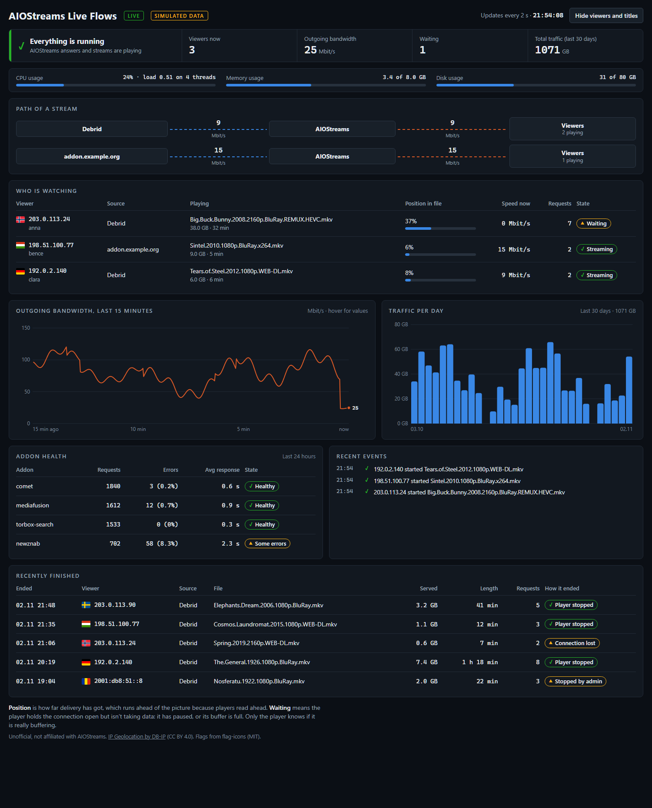

<p align="center">
  
</p>

<h1 align="center">AIOStreams Live Flows</h1>

<p align="center">
  <b>See who is streaming through your AIOStreams, right now</b><br/>
  One small container. It updates every 2 seconds and needs nothing besides AIOStreams.
</p>

<p align="center">
  <a href="https://github.com/pbalazs123/aiostreams-live-flows/tags"></a>
  <a href="LICENSE"></a>
  
  
  
</p>

<p align="center">
  <a href="#-features">Features</a> •
  <a href="#-try-it">Try It</a> •
  <a href="#-install">Install</a> •
  <a href="#-settings">Settings</a> •
  <a href="#-privacy-and-security">Privacy and Security</a> •
  <a href="#-troubleshooting">Troubleshooting</a>
</p>

---

<p align="center">
  <br/>
  <i>Demo mode. Every viewer, address and file here is simulated</i>
</p>

## ✨ Features

| | |
|---|---|
| **Who is watching** | IP address, country flag, username, file, position, speed and state of every stream |
| **Where it comes from** | Streams grouped by source: debrid, Usenet or the addon's host name |
| **Traffic** | Speed over the last 15 minutes and data served per day for 30 days |
| **Addon health** | Requests, errors and response times from the last 24 hours |
| **Server usage** | The host's CPU, memory and disk usage, with no agent to install |
| **History** | Recently finished streams and how they ended |
| **Private by default** | Opens on the local machine only, loads nothing from outside, and has a server-side setting to hide viewers |

---

## 🚀 Try It

Demo mode needs no AIOStreams and uses simulated data:

```bash
docker run --rm -p 127.0.0.1:8300:8300 -e FLOWS_DEMO=1 ghcr.io/pbalazs123/aiostreams-live-flows:latest
```

Then open <http://127.0.0.1:8300>.

---

## 📦 Install

You need AIOStreams running in Docker, and password login turned on.

**1. Add an admin user for the dashboard.** In AIOStreams' `AIOSTREAMS_AUTH`, add a user with a long random password that
has no commas or colons. Read [The admin login](#the-admin-login) first.

```bash
AIOSTREAMS_AUTH=you:yourpassword,liveflows:a-long-random-password
```

If you use `AIOSTREAMS_AUTH_PERMISSIONS`, also add `liveflows=admin` there. Then recreate AIOStreams so it picks up the change.

**2. Find the Docker network AIOStreams is on:**

```bash
docker inspect aiostreams --format '{{range $name, $net := .NetworkSettings.Networks}}{{println $name}}{{end}}'
```

**3. Get the files and fill in `.env`:**

```bash
mkdir aiostreams-live-flows && cd aiostreams-live-flows
curl -fsSLO https://raw.githubusercontent.com/pbalazs123/aiostreams-live-flows/main/compose.yaml
curl -fsSL https://raw.githubusercontent.com/pbalazs123/aiostreams-live-flows/main/.env.example -o .env
chmod 600 .env
nano .env
```

Set `AIOSTREAMS_NETWORK` to the network from step 2, and set `AIOSTREAMS_USER` and `AIOSTREAMS_PASSWORD`.

**4. Start it:**

```bash
docker compose up -d
```

Open <http://127.0.0.1:8300> on that machine. On a remote server, use an SSH tunnel:
`ssh -L 8300:127.0.0.1:8300 you@server`.

To update, run `docker compose pull && docker compose up -d`. To remove it, run `docker compose down`, then remove the
`liveflows` user from AIOStreams.

---

## ⚙️ Settings

| Setting | What it does |
|---|---|
| `AIOSTREAMS_URL` | How this container reaches AIOStreams. Default `http://aiostreams:3000` |
| `AIOSTREAMS_NETWORK` | The Docker network the two share. Default `aiostreams_default` |
| `AIOSTREAMS_USER`, `AIOSTREAMS_PASSWORD` | The admin login. Required |
| `FLOWS_PASSWORD` | Asks for a password on the page. Any username works |
| `FLOWS_HIDE_VIEWERS` | `1` removes IPs, usernames, countries and filenames on the server, so no browser ever gets them |
| `FLOWS_SOURCE_NAMES` | Nicer source names, such as `debrid=TorBox,addon.example.org=My addon`. The keys are `debrid`, `usenet`, `other` or a host name |
| `FLOWS_DEMO` | `1` shows simulated data and never contacts AIOStreams |
| `TZ` | Time zone for the logs. The page uses your browser's time |

---

## 🔒 Privacy and Security

### The admin login

AIOStreams has no read-only role, so this login **could also stop streams, ban viewers or change settings**. Live Flows
only logs in and then reads five dashboard feeds, and [the code](app/live_flows.py) refuses any other path. The tests check
this, but you are still trusting this program with an admin login.

- **Use a separate user**, so you can remove it without touching anything else.
- **Check your other users.** If `AIOSTREAMS_AUTH_PERMISSIONS` and the older admin list aren't set, AIOStreams makes
  every user in `AIOSTREAMS_AUTH` an admin. That includes logins you only hand out for proxying, once password login is on.
  Limit them with, for example, `AIOSTREAMS_AUTH_PERMISSIONS=you=admin,liveflows=admin,friends=proxy`.

### Keep it private

The page shows your viewers' IP addresses and what they are watching, so treat it as personal data.

- **By default only the machine it runs on can open it.** The port is bound to `127.0.0.1`.
- **Before you open the port or put it behind a reverse proxy:** set `FLOWS_PASSWORD`, and use HTTPS, because the password
  is sent with every request. There is no limit on password attempts, so a VPN or an access-controlled proxy is better
  than leaving it on the open internet.
- **To share the page with others,** set `FLOWS_HIDE_VIEWERS=1`. The button on the page only hides things on your screen.

### What it does and doesn't keep

- Stream URLs never reach the browser, only the source label.
- History and events stay in memory and are gone after a restart. It writes nothing to disk.
- Country lookups use a copy of the DB-IP file inside the image, so viewer IPs aren't sent anywhere.
- It has no telemetry and the page loads no outside fonts or scripts.
- The container runs as an unprivileged user on a read-only filesystem.

---

## 🚧 Limits

- **It only sees streams that go through AIOStreams:** its proxy or Usenet. A player connecting directly to a debrid service
  or addon doesn't appear.
- **It uses AIOStreams' internal dashboard API,** which isn't a public API and can change. If an update breaks it, the page says so.
- **AIOStreams doesn't say which debrid service a stream uses.** Those show as "Debrid", and `FLOWS_SOURCE_NAMES` can rename them.
- **Addon error counts come from AIOStreams' analytics,** and can miss some errors.
- **Disk usage is for the disk holding AIOStreams' container.** It can read a little higher than `df`, because AIOStreams appears to count space reserved for root as used.
- **One AIOStreams instance.** Several replicas haven't been tried.

### 🧪 Testing

Tested on AIOStreams 2.37.0 behind its proxy, against one real server with debrid and addon streams, using read-only
calls on 2 November 2026. The tests cover the login rules, what reaches the browser and the error messages.

**Not tested yet:** the published image and `compose.yaml` on a real server; arm64; real Usenet streams; debrid services other
than TorBox; other AIOStreams versions; login through OIDC.

---

## 🐛 Troubleshooting

**"AIOStreams refused the login"?** Check the user and password in `.env`, and that AIOStreams was recreated after you added the
user. Live Flows waits 5 minutes between attempts so it can't trip the login limit, so restart it after fixing this.

**"Password login is turned off in AIOStreams"?** Turn it on in AIOStreams' settings. Live Flows can't use OIDC.

**"This AIOStreams user is not an admin"?** Add `liveflows=admin` to `AIOSTREAMS_AUTH_PERMISSIONS` and recreate AIOStreams.

**"Can't reach AIOStreams"?** Check `AIOSTREAMS_NETWORK` and the container name in `AIOSTREAMS_URL`.

**"answered in an unexpected way"?** AIOStreams probably changed its API. Please
[open an issue](https://github.com/pbalazs123/aiostreams-live-flows/issues) with the version shown in the message.

**Nobody shows up while someone is watching?** That stream probably isn't going through AIOStreams' proxy. See [Limits](#-limits).

**Everything else?** Run `docker logs aiostreams-live-flows`.

---

## 🤝 Support

This is a hobby project with no support promises, so an AIOStreams update can break it for a while. Issues and pull requests
are welcome.

## 🙏 Acknowledgments

- [IP Geolocation by DB-IP](https://db-ip.com) for the country data (CC BY 4.0)
- [flag-icons](https://github.com/lipis/flag-icons) for the flags (MIT, licence in [`app/flags`](app/flags/LICENSE))

AIOStreams Live Flows is unofficial and not affiliated with [AIOStreams](https://github.com/Viren070/AIOStreams).

## 📄 License

[MIT](LICENSE)

<p align="center"><a href="https://github.com/pbalazs123/aiostreams-live-flows/issues">Report a problem</a></p>
